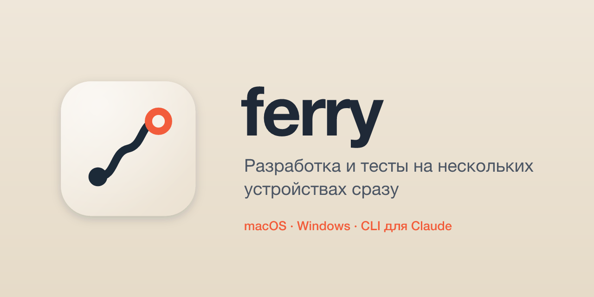

Разработка и тесты на нескольких устройствах сразу: код пишешь здесь, а собираешь, запускаешь и смотришь на экран — на любом связанном устройстве, в том числе на настоящем рабочем столе Windows. На каждом устройстве — приложение ferry; команды идут отсюда через приложение на этой машине. Рассчитан и на человека, и на Claude: всё — обычные команды с выводом и кодом выхода.

```sh
ferry devices                                   # устройства: на связи ли, путь, роль, режим
ferry run win-10 -- cargo test                  # снимок проекта, затем команда там же в проекте
ferry run all -- bun test                       # на всех узлах сразу; строки с [устройство]
ferry run os:windows --desk -- bunx playwright test --project=live --reporter=line
ferry start win-10 app -- ./target/debug/app.exe --remote-debugging-port=9322
ferry tunnel win-10 9322                        # CDP приложения на узле — здесь, на 127.0.0.1:9322
ferry log win-10 app -f                         # лог задачи; выйдет с её кодом
ferry shot win-10                               # снимок экрана → ~/.ferry/shots/win-10.png
ferry click win-10 458 390                      # настоящий клик ОС в точку снимка
ferry get win-10 playwright-report              # отчёт, логи, сборка — сюда
```

`ferry` без аргументов — полный список команд.

## Начать

1. Поставь приложение ferry на каждое устройство — из [релизов](https://github.com/Q1zin/ferry/releases): `ferry_<версия>_aarch64.dmg` на мак, `ferry_<версия>_x64-setup.exe` на Windows (ставится в профиль пользователя, без прав администратора). Оно живёт в трее и запускается при входе в систему.
2. Свяжи устройства: на новом — «Связать устройство» → «Показать код» (или `ferry pair`), на своём — введи код (`ferry pair 4821-0937`). В одной сети устройство находится само; из другой — вводят ссылку `ferry:<ключ>:<код>`.
3. Команда `ferry` в терминале — на машине, откуда управляешь: «Настройки» → «Поставить команду ferry». Она едет с приложением и ходит в приложение на этой же машине.
4. Для Claude Code — `ferry skill`: скилл в `~/.claude/skills/ferry` объясняет ему, как собирать, запускать и смотреть на других устройствах.

## Цели

`<цели>` в командах — имя устройства (или начало ключа), несколько через запятую, `all` — все на связи, которые принимают команды, `os:windows` / `os:macos` — по системе. На нескольких целях команда идёт параллельно, строки вывода подписаны `[устройство]`, в конце — сводка кодов, а код выхода — первый ненулевой. Устройство, отказавшее по режиму или роли, отвечает кодом 75.

## Команды и проект

`ferry run <цели> [--desk] [--no-sync] -- <команда>` сначала кладёт на устройство снимок проекта, затем выполняет команду в том же подкаталоге проекта (вне репозитория — в домашнем каталоге устройства). Вывод — потоком, код выхода — устройства. Прервал CLI (Ctrl-C, таймаут) — команда на устройстве останавливается.

- **Снимок** — рабочее дерево как есть: с незакоммиченным и новыми файлами. Он коммитится вне веток и без родителя: ветка и индекс здесь не меняются, на устройство в первый раз едет только дерево, дальше — только разница (git-бандл). Проект живёт на устройстве в `~/ferry/<имя репозитория>`. Файлы из `.gitignore` (`target/`, `node_modules/`) не ездят — кроме перечисленных в `files` настроек проекта.
- **Правки на устройстве** не теряются: если там правили поверх снимка, перед перезаписью они сохраняются патчем в `~/.ferry/saved/`. `ferry pull <устройство>` применяет их к рабочему дереву здесь.
- **`--desk`** — команде нужен рабочий стол (окна, GUI-тесты): в режиме «не трогать рабочий стол» такие отклоняются. Команды идут в сессии пользователя, где живёт приложение, — окна видны, ввод работает.
- `ferry sync <цели>` — только снимок; `ferry put <цели> <файл>…` — файлы отсюда на то же место в проекте; `ferry get <устройство> <путь> [куда]` — файл или каталог оттуда (`~/…` — от дома устройства).

## Фоновые задачи и туннели

`run` ждёт конца команды. Для того, что живёт дальше — запущенное приложение, dev-сервер, долгая сборка, — фоновая задача:

```sh
ferry start win-10 app -- ./src-tauri/target/debug/logarithmica.exe --remote-debugging-port=9322
ferry jobs win-10                 # работает / завершилась, код N / остановлена
ferry log win-10 app -f           # следить за логом; выйдет с кодом задачи — так можно ждать сборку
ferry kill win-10 app             # то же имя в start — перезапуск
ferry stop win-10                 # снять всё: команды и задачи
```

Задача идёт на рабочем столе устройства под своим процессом-надсмотрщиком (это exe приложения): переживает перезапуск приложения, лог и код выхода лежат в `~/.ferry/jobs/<имя>/` на устройстве.

Туннель делает порт устройства локальным — тем же номером, потому что CDP отдаёт ws-адрес со своим портом. Туннель держит приложение здесь, пока не закроешь:

```sh
ferry tunnel win-10 9322           # 127.0.0.1:9322 здесь → 9322 на устройстве
ferry tunnel                       # открытые туннели
ferry tunnel win-10 9322 --close
```

Так Playwright (`chromium.connectOverCDP('http://127.0.0.1:9322')`) и MCP `cef` работают с приложением на устройстве как с локальным:

```sh
claude mcp add cef-win-10 -- npx -y @playwright/mcp@0.0.83 --cdp-endpoint http://127.0.0.1:9322
```

Playwright из Bun через CDP не подключается (WebSocket так и не открывается) — запускай его на Node.

## Экран устройства: окна, ввод, запись

Ввод через CDP идёт в рендерер в обход ОС — нативные баги фокуса так не воспроизвести. Эти команды работают как человек за клавиатурой: события ввода и окна самой ОС — `SendInput` на Windows, CGEvent на маке. Координаты — пиксели снимка `ferry shot` (на Retina — настоящие пиксели, вдвое больше точек), поэтому цикл «снимок → нашёл кнопку → клик → снимок» работает напрямую.

На маке снимкам нужен доступ к записи экрана, вводу — к «Универсальному доступу». Страница «Разрешения» в окне ferry показывает оба и открывается сама, пока чего-то не хватает: «Выдать» — раздел «Системных настроек», где включить ferry; запись экрана macOS применяет после перезапуска ferry (кнопка там же). Выдаются один раз: сборки из релизов подписаны одним сертификатом, и обновления доступы не сбрасывают. Элементы окон (`ui`, `--name`) и лист-обзор записи — пока только на Windows.

```sh
ferry windows win-10                     # окна сверху вниз по z-порядку; * — у кого фокус
ferry ui win-10                          # элементы окна с фокусом: роль, «имя», #id, место
ferry click win-10 --name "Сохранить"    # клик по имени элемента
ferry click win-10 458 390 [right|double]
ferry move win-10 458 390                # навести (hover)
ferry scroll win-10 -3                   # колесо: больше нуля — вверх
ferry type win-10 'Привет, мир'          # юникодом: раскладка не важна
ferry key win-10 ctrl+a delete alt+f4    # комбинации по порядку
ferry rec win-10 6 [4]                   # 6 с по 4 кадра → ~/.ferry/recs/<устройство>-<время>/
```

Клик по пикселям хрупок (другой масштаб экрана — и кнопка уехала). Надёжнее — по имени элемента: `ferry ui win-10 [<процесс|часть заголовка>]` печатает элементы окна (UI Automation: роль, «имя», #id, место), `ferry click win-10 --name "Сохранить"` кликает в центр элемента с этим именем в окне с фокусом, `--name '#15'` — по #id для безымянных элементов (`move --name` — навести). Веб-интерфейсы (WebView2, Chromium) тоже отдают свои кнопки и поля.

`rec` печатает путь к `sheet.png` — до 12 равномерно выбранных кадров с отметкой времени на одном листе. Есть `ffmpeg` здесь — рядом появится и `video.mp4`. Чего ввод не может: окна, запущенные от администратора, заблокированный экран и окно UAC.

## Приватные git-зависимости: релей

Ключ от GitLab/GitHub есть только у тебя, а `cargo`, `bun`, `npm` и сам `git` на устройстве достают приватные репозитории по SSH:

```sh
ferry trust git.logarithmica.ru     # один раз здесь; ferry trust — список
```

Команды, которые ты запускаешь на устройстве, получают `GIT_SSH_COMMAND='<exe приложения> ssh'`. Для доверенного хоста это не ходит в сеть само: сессия уходит в приложение устройства и по связи ferry — к тебе, а здесь выполняется твоим ssh. Ключ отсюда не уходит.

- **Только чтение**: `git-upload-pack` и `git-upload-archive`. Push с устройства отклоняется — скомпрометированное устройство не запушит от твоего имени.
- **Только доверенные хосты** из `~/.ferry/trust` здесь; аргументы проверяются так, чтобы ни одно поле не стало опцией ssh.
- Недоверенные хосты — обычный ssh устройства. cargo по умолчанию ходит в git мимо `GIT_SSH_COMMAND`, поэтому ferry ставит ему `CARGO_NET_GIT_FETCH_WITH_CLI=true`.

## Роль и режим

- **Роль** — что устройство делает: узел (принимает команды), пульт (только управляет другими) или оба. Меняется с любого связанного устройства: `ferry role win-10 node` или в окне.
- **Режим** выбирает только человек за устройством — в трее или в окне:

| Режим | Иконка | Что значит |
|---|---|---|
| `active` — работает | коралловая | обычная работа |
| `no-desktop` — не трогать рабочий стол | фиолетовая, как «Не беспокоить» | `--desk`, задачи, снимки и ввод отклоняются (код 75), сборки идут |
| `paused` — отключён от других устройств | серое кольцо | ничего не выполняется, роль и имя издалека не меняются |

Пока с другого устройства вводят, снимают экран или запускают окна, иконка ferry здесь белая, а подсказка говорит, кто управляет; «Остановить управление» в её меню включает «не трогать рабочий стол». Через 15 с без таких действий иконка возвращается к обычной. Всё, что связанные устройства делали на этом, — в журнале на его странице в окне и в `~/.ferry/logs/ferry.log` (набранный текст туда не попадает).

Windows может спрятать новую иконку под «^» у часов — перетащи её на панель один раз.

## Связь

- **iroh**: устройство адресуется ключом, а не IP — сменился адрес, VPN, другая сеть, связь та же. Шифрование сквозное, связанные устройства доверяют друг другу.
- В одной сети — напрямую. Поиск соседей — mDNS только на LAN-интерфейсах: у VPN свой маршрут на multicast. Из разных сетей — через публичные relay n0 с пробивкой NAT до прямого пути.
- DNS — публичные серверы через HTTPS и системный резолвер одновременно, ответ — первый успешный: с VPN системный DNS ломается, в корпоративной сети наружу закрыт любой DNS, кроме своего.
- UDP-порт 47760: после перезапуска устройство на том же адресе, и остальные снова достают до него за секунды. Занят — любой свободный.
- Устройство пропало — видно через ~12 с. Состояние (режим, роль, путь) приходит само, без опроса.

Связывание: код из 8 цифр, 10 минут, 5 попыток. В сеть код не уходит (SPAKE2): подставное устройство его не узнает.

## Настройки проекта

Хранятся здесь, в репозиторий не попадают: `~/.ferry/projects/<проект>.toml` (`<проект>` — имя каталога репозитория).

```toml
files = [".env"]             # sync возит их на устройство мимо git
```

## Приложение

Одно на любом устройстве (macOS, Windows): в трее — режим этого устройства, «Открыть ferry», «Связать устройство…», «Выйти». Закрытое окно ferry не останавливает.

- **Устройства** — это и связанные: путь (напрямую или через relay), задержка, роль, режим.
- **Страница устройства**: «Обзор» — роль, режим, имя, свойства (система, железо, диск, питание) и питание (Windows); «Экран» — снимок, живой экран, клики по снимку уходят на устройство, текст и клавиши; «Задачи» — список, лог, запуск и остановка.
- **Связать устройство** — показать код или ввести код/ссылку; рядом видно устройства, которые ждут связывания.
- **Настройки** — запуск при входе в систему, команда `ferry` в терминале, обновления.

Ключ устройства, имя, роль и связанные устройства — в `~/.ferry` (`key`, `device.json`); `~/.ferry/app` — порт и токен для CLI.

Лог приложения — `~/.ferry/logs/ferry.log`. Что-то не так на устройстве — его хвост отсюда: `ferry logs win-10 [-n 300]`; `ferry logs` без цели — лог этой машины.

## Обновления

Новые версии — релизы на GitHub. Приложение проверяет их при запуске: есть новая — у «Настройки» в окне появится «есть <версия>». Ставит человек — в настройках — или ты отсюда:

```sh
ferry update                      # эта машина
ferry update all                  # связанные на связи; пульт — по имени: ferry update macbook
```

Устройство скачивает пакет, отвечает и ставит его: Windows запускает приложение после установки сама, мак — перезапускает. Через несколько секунд устройство снова на связи с новой версией. Пакет подписан ключом ferry, неподписанный приложение не поставит. Устройство в режиме «отключён» издалека не обновляется.

Устройства разных версий работают вместе. Команда, которой устройство ещё не знает, не уходит на него, а сразу отвечает: «на win-10 ferry 0.1.2, а ferry logs — с 0.1.3: обнови его — ferry update win-10».

## Устройство репозитория

| Каталог | Что там |
|---|---|
| `crates/ferry-core` | логика устройства: задачи, экран и ввод, снимок проекта, релей git (проверки), режимы; общие типы и локальное управление приложением |
| `crates/ferry-net` | связь поверх iroh: агент, протокол устройств (irpc), связывание, поиск в сети, файлы, туннели, релей |
| `crates/ferry` | CLI — тонкий клиент приложения на этой машине |
| `apps/ferry` | приложение на Tauri (Vue + TS): агент, трей, окно |

## Сборка и проверка

```sh
cd apps/ferry && bun install
bunx tauri build --debug --bundles app      # → target/debug/bundle/macos/ferry.app
bunx tauri build --target x86_64-pc-windows-gnu --no-bundle   # ferry-app.exe (brew install mingw-w64);
                                            # рядом с ним нужен WebView2Loader.dll из того же каталога target
cargo install --path crates/ferry           # CLI из исходников
```

```sh
cargo test                                  # ядро, связь (агенты в одном процессе), CLI целиком
bun run build && bun run test:ui            # смоук-тест интерфейса в Chromium (в apps/ferry)
bun run icons                               # иконки приложения и трея из исходников
```

`cargo test` поднимает агентов прямо в тесте: связывание и его отказы, события, роли и режимы, команды с выводом и отменой, обновление, снимок проекта и правки на устройстве, файлы, туннель, релей git и настоящий бинарник `ferry` поверх приложения.

## Релиз

Версия одна — `version` в корневом `Cargo.toml`; после релиза её сразу поднимают до следующей, и новые запросы протокола помечают ей (`Device::need`). Сборки релиза подписываются ключом обновлений: приватный — у того, кто выпускает (`~/.tauri/ferry.key`, в GitHub — секрет `TAURI_SIGNING_PRIVATE_KEY`), публичный — в `tauri.conf.json`. Потерян приватный ключ — установленные копии новых версий не примут, их придётся переставить руками.

Релиз собирает GitHub Actions (`.github/workflows/release.yml`) по тегу с той же версией:

```sh
git tag v<версия> && git push origin v<версия>
```

Сборки для macOS и Windows, пакеты обновления и `latest.json` попадают в черновик релиза — устройства увидят новую версию, когда его опубликуют. Без тега (Actions → release → Run workflow) — только сборка, файлы в артефактах прогона.

То же локально, без Actions:

```sh
cd apps/ferry
export TAURI_SIGNING_PRIVATE_KEY="$HOME/.tauri/ferry.key" TAURI_SIGNING_PRIVATE_KEY_PASSWORD=
bun run release:mac                         # dmg и пакет обновления для мака (Apple Silicon)
bun run release:windows                     # setup.exe (brew install mingw-w64 nsis)
bun run release:files                       # → target/release-v<версия>/: установщики, пакеты, latest.json
gh release create v<версия> ../../target/release-v<версия>/*
```

Приложение ищет `latest.json` последнего релиза, поэтому новая версия доходит до устройств, как только релиз опубликован. Мак подписан своим самоподписанным сертификатом (`apps/ferry/src-tauri/macos-signing.pem`; ключ — у того, кто выпускает, в `~/.tauri/ferry-macos.p12`, в GitHub — секреты `MACOS_CERTIFICATE` и `MACOS_CERTIFICATE_PASSWORD`). Требование к подписи у всех сборок одно, поэтому доступы macOS переживают обновления; локальные сборки — ad-hoc. Нотаризации нет: скачанное из браузера приложение macOS в первый раз не запустит — «Системные настройки» → «Конфиденциальность и безопасность» → «Всё равно открыть». Обновления это не затрагивает.
